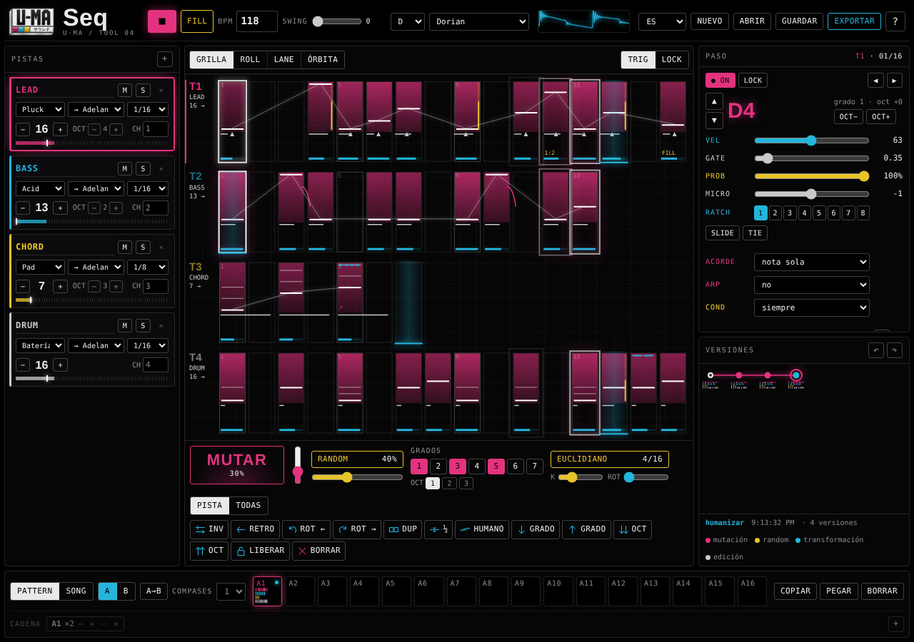

# Seq / U-MA

Secuenciador en el navegador para **probar secuencias**: armarlas, escucharlas con un sonido básico interno y bajarlas al DAW o a un script de norns. No es para tocar en vivo ni para mezclar: todo apunta a la secuencia.

**Abrir la app → https://buenosairesfront.github.io/seq/**

Es parte de las herramientas de **Buenos Aires Front** (U-MA / Tool 04).



## La idea

El centro es la **mutación con memoria**: generás, bloqueás los pasos que te gustan, mutás el resto y navegás el **árbol de versiones** para volver a cualquier variante sin perder las nuevas.

## Qué trae

**La grilla**
- Cada paso guarda capas: nota, velocity, gate, probabilidad, ratchet (1–8), micro-timing, slide, tie, acorde, arpegio, condición y parameter locks (CC).
- Cuatro vistas del mismo pattern: **Grilla** (tipo 303 / Elektron, con todas las capas dibujadas en cada paso), **Roll** (piano roll por grados), **Lane** (una sola capa como barras, o curvas de modulación) y **Órbita** (cada pista es un anillo, así se ven los polirritmos).
- Largo por pista independiente (1–64 pasos): 16 contra 13 contra 7 sale solo.
- Dirección por pista: adelante, atrás, ping-pong, random y drunk. División de reloj por pista (1/4 a 1/32, con tresillos).
- Hasta 8 pistas, cada una con su canal MIDI.

**Escalas y armonía**
- Las notas son **grados de la escala**, no notas fijas. Cambiar de tónica o de modo (dórico → frigio) rearmoniza el pattern sin romperlo.
- 16 escalas: los siete modos, menor armónica y melódica, pentatónicas, blues, Hirajoshi, In sen, tonos enteros y cromática.
- Acordes por paso (tríada, sus, séptima, novena, power…) y arpegio dentro del paso.

**Generación y transformación (a un toque)**
- **Mutar** con porcentaje, respetando los pasos bloqueados.
- **Random con restricciones**: grados permitidos (por ejemplo solo 1, 3 y 5), densidad y rango de octavas.
- **Euclidiano** por pista: pulsos, pasos (el largo de la pista) y rotación.
- Invertir, retrogradar, rotar, duplicar, comprimir a la mitad, humanizar, transponer por grado y por octava.
- Alcance: la pista elegida o todas.
- **Árbol de versiones** por pattern, con miniaturas de cada variante.

**Más allá de la nota**
- Parameter locks: cualquier paso puede llevar uno o varios CC.
- Dos lanes de modulación por pista, dibujables a mano o con formas (seno, triángulo, rampas, exponencial, random), con curvas suaves.
- Condiciones estilo Elektron: `1:2`, `3:4`… (vuelta X de cada Y), `PRE` / `!PRE` (si el anterior sonó o no), `FILL` / `!FILL`, `1ST` / `!1ST`.

**Estructura**
- 16 patterns (A1–A16) con miniaturas, copiar / pegar / borrar.
- Variaciones **A/B** del mismo pattern y copia A→B.
- **Song mode**: cadena de patterns con repeticiones.

**Exportar**
- **MIDI** (.mid) multipista o una pista por archivo, por pattern o por cadena, con largo en compases o el ciclo completo del polirritmo. Incluye acordes, ratchets, micro-timing, CC y lanes.
- **Perfiles de equipo** para el MIDI: General / DAW, Elektron (Digitakt, Digitone, Syntakt), Model:Cycles / Samples, TB-03 (mono, acentos, slides), Monologue (mono, legato) y Polyend.
- **JSON** legible (pattern o proyecto completo).
- **Tabla Lua para norns**, lista para pegar en un script, con matriz de batería estilo caja16 y un reproductor mínimo opcional.
- **Texto** legible tipo tracker.
- **MIDI en vivo** por Web MIDI (Chrome, Edge, Firefox; Safari no lo soporta).

**Interfaz**
- Estética U-MA: fondo negro, líneas finas y cada capa en un color de la paleta (magenta notas, cian velocity, amarillo probabilidad, plata gate).
- Seis idiomas: español, English, Deutsch, 日本語, हिन्दी, 中文.
- Funciona en celular, se puede instalar como app y guarda todo en el navegador.

## Uso rápido

1. Abrí la app y tocá ▶ (o la barra espaciadora). Arranca con un pattern demo en polirritmo 16 / 13 / 7.
2. Tocá pasos en la grilla para encenderlos; tocá uno encendido para elegirlo y editar sus capas a la derecha.
3. Con **LOCK** marcá los pasos que te gustan y tocá **MUTAR** varias veces.
4. En **Versiones** tocá cualquier punto del árbol para volver a esa variante.
5. **EXPORTAR** → MIDI, JSON, Lua o texto.

El manual completo está en [`docs/MANUAL.md`](docs/MANUAL.md).

## Documentación

| Archivo | Contenido |
| --- | --- |
| [`docs/MANUAL.md`](docs/MANUAL.md) | Manual de uso: vistas, capas, generación, árbol, banco, song mode, teclas. |
| [`docs/FORMATOS.md`](docs/FORMATOS.md) | Exportaciones: MIDI y perfiles de equipo, JSON, tabla Lua para norns, texto, y por qué no hay .seq ni SysEx nativos. |
| [`docs/LANDING.md`](docs/LANDING.md) | Cómo enlazar Seq desde la landing de Buenos Aires Front. |
| [`docs/PUBLICAR.md`](docs/PUBLICAR.md) | Publicación en GitHub Pages, correrla local y actualizarla. |
| [`ejemplos/`](ejemplos/) | El pattern demo exportado en todos los formatos. |

## Estructura del repo

```
index.html            la app (estructura y logo)
css/seq.css           estilos
js/i18n.js            textos en 6 idiomas
js/core.js            modelo, escalas, evaluación de pasos, transformaciones, árbol de versiones
js/audio.js           sonido de preview (Web Audio) y reloj de secuencia
js/export.js          render determinista y exportación MIDI / JSON / Lua / texto
js/ui.js              vistas en canvas, inspector, generación, banco, exportar
favicon.svg, icon-*.png, manifest.webmanifest, sw.js   ícono e instalación como app
landing.json          datos de la tarjeta para la landing de Buenos Aires Front
docs/                 manual, formatos, landing, publicación y capturas
ejemplos/             el pattern demo en .json, .lua, .txt y .mid
```

Sin dependencias ni compilación: HTML, CSS y JavaScript planos.

## Correr local

Doble clic en `index.html`, o un servidor estático:

```sh
python3 -m http.server 8000
# abrí http://localhost:8000
```

## Compatibilidad

Safari, Chrome, Edge y Firefox actuales, en escritorio y celular. En iPhone, si no se oye, revisá el interruptor de silencio. El MIDI en vivo necesita Web MIDI (no está en Safari); la exportación .mid funciona en todos.

## Licencia

Copyleft: **GNU GPL v3** (ver [`LICENSE`](LICENSE)). Podés usar, estudiar, modificar y redistribuir Seq, siempre que las versiones que publiques sigan bajo la misma licencia y con el código disponible.

---

### English

Seq is a browser sequencer for **trying out sequences** and taking them to your DAW or a norns script. Its core is *mutation with memory*: generate, lock what you like, mutate the rest and browse the version tree. Steps carry note (as scale degree), velocity, gate, probability, ratchet, micro-timing, slide/tie, chords, arp, Elektron-style conditions and CC locks; tracks have independent lengths and play directions. Export to multitrack MIDI with device profiles, JSON, a Lua table for norns, or text. The interface is available in Spanish, English, German, Japanese, Hindi and Chinese. **Open it → https://buenosairesfront.github.io/seq/**

License: copyleft, GNU GPL v3 (see `LICENSE`).
